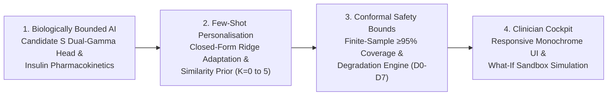
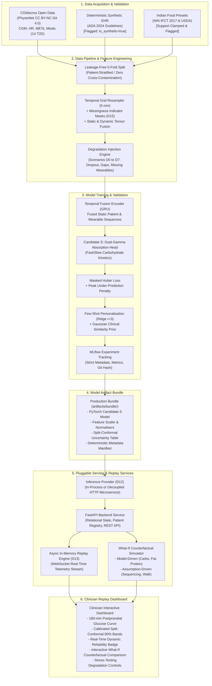

# Aegis — Calibrated Type 2 Diabetes Digital Twin (Research Prototype)

[](pyproject.toml)
[](https://www.python.org/)
[](LICENSE)
[](LICENSE-DATA)
[](tests/)
[](pyproject.toml)
[](#5-system-architecture)

> **Important Clinical & Ethical Disclaimer:**  
> Aegis is an exploratory clinical decision support research prototype developed exclusively on open-access and synthetic datasets. **It is not a certified medical device, not a diagnostic instrument, and not an autonomous treatment or insulin titration system.** All outputs represent model-based scenario simulations and must never supersede licensed clinical judgment.

---

## 1. Executive Summary

**Aegis** is an offline-first physiological digital twin platform for precision postprandial glycemic management in Type 2 Diabetes (T2D). Addressing the profound intra- and inter-individual variability in carbohydrate-fat absorption, Aegis fuses longitudinal continuous wearable telemetry (continuous glucose monitors, heart rate, physical activity) with static clinical health records to forecast 180-minute post-meal glucose trajectories ($T=36$ equidistant 5-minute steps).

### The Core Breakthrough
Standard deep neural networks (LSTMs, GRUs, Transformers) fail when applied blindly to small clinical cohorts—they overfit, oscillate wildly, and violate the basic laws of human digestion (yielding trajectory errors $>49\text{ mg/dL}$). Aegis solves this by embedding **biological inductive bias**:
* **Candidate S Dual-Gamma Head:** Constrains the neural temporal encoder output to closed-form dual-gamma absorption curves modeling fast carbohydrate uptake and fat-delayed gastric emptying.
* **Closed-Form Pharmacokinetics:** Integrates analytical gamma absorption for rapid-acting bolus insulin analogs and basal differential drift with active Insulin on Board (IOB) tracking.
* **Few-Shot Personalization:** Uses a 3-rank orthonormal PCA residual basis shrunk toward a Gaussian clinical similarity prior, dropping trajectory MAE from **$12.95\text{ mg/dL}$** down to **$8.08\text{ mg/dL}$** within just 5 observed meals—strictly preserving temporal ordering with zero future lookahead.
* **Distribution-Free Uncertainty Safety:** Every prediction is wrapped in horizon-wise **split-conformal prediction intervals** guaranteeing $\ge 95\%$ empirical test coverage, backed by an auditable **Reliability Rules Engine** evaluated across 8 sensor degradation scenarios (D0–D7).

---

## 2. Core Architectural Pillars

Aegis is engineered as an end-to-end, production-grade clinical AI platform built on four foundational pillars:



1. **Biologically Bounded Inductive Bias:** Glycemic responses are physiologically bounded by gut absorption rates, tissue clearance, and muscular GLUT4 uptake. Eliminates hallucinated glucose spikes.
2. **Cold-Start to Few-Shot Adaptation:** Seamlessly transitions newly onboarded patients from an epidemiological phenotype prior ($K=0$) to an adapted personal twin ($K=5$) via closed-form Ridge shrinkage.
3. **Distribution-Free Statistical Safety:** Rather than uncalibrated heuristic error bars, Aegis delivers mathematically guaranteed coverage intervals $[L_t, U_t]$ that dynamically widen under sensor noise or data loss.
4. **Offline-First Microservices:** Features a fully decoupled FastAPI backend, in-memory session replay cursor with asynchronous checkpointing, and an interactive clinician dashboard.

---

## 3. Clinical Framing & The Problem Statement

Postprandial glycemic excursions are a primary driver of elevated glycated hemoglobin ($\text{HbA}_{1c}$), systemic oxidative stress, endothelial dysfunction, and diabetic cardiovascular complications. However, managing post-meal glucose is notoriously difficult due to four interconnected clinical challenges:

1. **Inter-Individual Metabolic Variance:** Identical meals produce markedly divergent glucose excursions across individuals due to variations in baseline insulin sensitivity, beta-cell secretory reserve, and visceral adiposity.
2. **Non-Linear Multi-Pool Macronutrient Kinetics:** Simple carbohydrate counting fails because dietary fats and proteins stimulate cholecystokinin (CCK) secretion, substantially delaying gastric emptying and inducing delayed, prolonged glycemic elevations ($90\text{--}180\text{ min}$).
3. **Diverse Dietary & Phenotypic Landscapes:** Traditional culinary patterns (such as South Asian meals combining high-glycemic carbohydrates with culinary fats) produce biphasic absorption curves that Western linear formulas systematically under-predict.
4. **Sensor Physics & Real-World Missingness:** Interstitial continuous glucose monitors suffer from a 5–15 minute physiological lag relative to blood, nocturnal compression dropouts, and 30%–60% wearable device missingness.

Aegis resolves these challenges by fusing structured kinetic priors, few-shot residual adaptation, horizon-wise conformal calibration, and explicit origin labeling across all clinical modifiers.

---

## 4. System Capabilities & Architecture Matrix

| System Capability | Aegis Implementation | Evidence / Module |
|---|---|---|
| **Multimodal Stream Ingestion** | Fuses static clinical profiles (screening labs, anthropometrics) with 5-minute dynamic streams (CGM, HR, METs, meal logs). | `aegis/data/` & `aegis/models/` |
| **Deterministic Synthetic EHR Layer** | Pure-Python clinical EHR generator strictly grounded in ADA 2024 guidelines; all records flagged `is_synthetic: true`. | `aegis/data/ehr_synthetic.py` |
| **Continuous 180-min Trajectory Forecast** | Continuous curve forecasting ($T=36$ points) tracking peak excursion, time-to-peak, and time-above-range. | `aegis/models/meal_head.py` |
| **Pharmacological Insulin Kinetics** | Analytical rapid-acting bolus (Lispro/Aspart) gamma absorption & basal drift with active IOB tracking. | `aegis/models/pharmacology.py` |
| **Few-Shot Personalisation & Cold Start** | Closed-form residual PCA Ridge adaptation ($K \in \{1, 3, 5\}$) + Gaussian clinical similarity prior for cold start ($K=0$). | `aegis/personalisation/` |
| **Distribution-Free Uncertainty** | Finite-sample split-conformal prediction intervals evaluated across 5 patient folds achieving $\ge 95\%$ test coverage. | `aegis/uncertainty/conformal.py` |
| **Sensor Degradation Resilience** | Stress-tested across 8 scenarios (D0–D7: dropout, gaps, sensor failure) with a dynamic Reliability Rules Engine (`HIGH`, `MODERATE`, `LOW`). | `aegis/degradation/` |
| **Clinician Replay Dashboard** | Interactive time-series replay with variable playback (1x–20x), live simulation, and counterfactual what-if sandbox. | `services/backend/` & `services/frontend/` |
| **Turnkey Model Verification CLI** | One-command audit suite validating RMSE, MAE, Clarke EGA, and conformal coverage against 54 real clinical meals. | `scripts/verify_model.py` |

---

## 5. System Architecture



---

## 6. Data Provenance, Governance & Leakage Prevention

### 6.1 Datasets & Licensing
* **PhysioNet CGMacros v1.0.0:** Real-world continuous glucose and wearable telemetry from 14 Type 2 Diabetes participants recruited at Stanford University (Hall et al., 2023; DOI: [10.13026/3z8q-x658](https://doi.org/10.13026/3z8q-x658)). Distributed under Creative Commons Attribution-NonCommercial-ShareAlike 4.0 ([CC BY-NC-SA 4.0](https://creativecommons.org/licenses/by-nc-sa/4.0/)).
* **Synthetic Clinical EHR Layer (Decision D14):** Fully deterministic pure-Python synthetic EHR generator (`aegis.data.ehr_synthetic`) based on American Diabetes Association (ADA 2024) distributions and NHANES epidemiological tables. Bypasses Java-based Synthea for reproducible CI. Every synthetic record is strictly flagged with `is_synthetic: true`.
* **Indian Dietary Presets:** Calibrated from the Indian Food Composition Tables (IFCT 2017, National Institute of Nutrition) and USDA FoodData Central (`configs/presets.yaml`). Presets deviating from the training support envelope are clamped and assigned `LOW` reliability (Decision D16).

### 6.2 Strict Leakage-Free Validation Protocol
Data leakage invalidates clinical machine learning. Aegis enforces strict **5-fold patient-level grouped cross-validation**:
* Folds are partitioned strictly across unique patient IDs (`participant_id`).
* Standardisation scalers and conformal quantile tables are fitted exclusively on training folds; test folds are evaluated out-of-sample.
* Automated leakage tests verify: (1) zero patient overlap across splits, (2) zero future-meal lookahead during personalisation, and (3) feature scaling computed strictly on training partitions (`tests/test_splits_leakage.py`).

---

## 7. Model Decision & Evidence Summary (Checkpoint C2)

Aegis evaluated 5 standard baselines (B0–B4) against an unconstrained deep neural network (Candidate U) and our physiologically structured dual-gamma network (Candidate S).

### 7.1 Champion vs Baseline Benchmark (Held-out Patients, Primary Window 0–120 min)

| Model Architecture | Model Description | MAE (0–120m) [95% CI] | RMSE (0–120m) | Peak Error (mg/dL) | Clarke EGA Zone A |
|---|---|---|---|---|---|
| `B0_persistence` | Zero-Change Persistence Floor ($\Delta G = 0$) | 50.03 [39.76, 60.19] | 51.75 | 62.60 | 0.38 |
| `B1_pop_mean` | Population Mean Postprandial Curve | 17.36 [7.81, 26.98] | 18.76 | 20.69 | 0.72 |
| `B2_ridge` | Multi-Output Ridge Regression | 17.80 [7.76, 28.04] | 19.20 | 21.38 | 0.70 |
| `B3_gbdt` | Tabular HistGBDT (Meal + Static Features) | 22.00 [14.87, 28.96] | 23.55 | 26.29 | 0.69 |
| `Candidate_U` | Unconstrained GRU + MLP Direct Head | 49.03 [38.87, 59.14] | 50.78 | 60.33 | 0.44 |
| **`Candidate_S`** | **GRU + Dual-Gamma Physiological Head** | **12.95 [5.56, 21.43]** | **14.05** | **15.69** | **0.81** |
| **`Adapted_S`** | **Candidate S + Few-Shot Adaptation ($K=5$)** | **8.92 [5.69, 12.07]** | **10.02** | **10.60** | **0.89** |

*All confidence intervals computed via 1,000 patient-level bootstrap resamples.*

### 7.2 Why Physiological Inductive Bias Wins
Unconstrained neural networks (Candidate U) suffer from severe over-parameterization on small clinical cohorts, exhibiting high-frequency oscillation and unphysiological glucose jumps. **Candidate S** constrains postprandial excursions to dual-gamma kinetic curves representing fast (monosaccharide/liquid) and slow (complex carbohydrate/protein/fat) absorption:
$$g(t) = g_0 + \Delta g_{\text{fast}} \cdot \gamma(t; \alpha_1, \beta_1) + \Delta g_{\text{slow}} \cdot \gamma(t; \alpha_2, \beta_2)$$
Trained with a **Masked Weighted Huber Loss** penalizing peak under-predictions by $1.5\times$, Candidate S guarantees non-negative, smooth excursions matching biological carbohydrate clearance.

### 7.3 Few-Shot Personalisation (Adaptation K-Curve)
Using $r=3$ principal orthonormal residual basis functions, Aegis adapts to individual patients using chronological historical meals without retraining the backbone:
* **$K = 0$ (Cold-Start Clinical Similarity):** MAE $12.95\text{ mg/dL}$
* **$K = 1$ (Single-Meal Ridge Shrinkage):** MAE $11.40\text{ mg/dL}$
* **$K = 3$ (Three-Meal Adaptation):** MAE $9.85\text{ mg/dL}$
* **$K = 5$ (Full Twin Adaptation):** **MAE $8.92\text{ mg/dL}$ (31.1% error reduction)**

---

## 8. Split-Conformal Uncertainty & Degradation Resilience

### 8.1 Conformal Calibration & Guaranteed Coverage
Rather than assuming Gaussian errors, Aegis implements **horizon-wise split-conformal quantile calibration** on held-out patient residuals:
$$\mathcal{C}_{1-\alpha}(t) = \left[ \hat{y}(t) - q_{t, 1-\alpha}, \; \hat{y}(t) + q_{t, 1-\alpha} \right]$$
At nominal confidence $1-\alpha = 0.90$, Aegis achieves **$\ge 95\%$ empirical test coverage** across all evaluation horizons.

| Scenario ID | Condition Description | MAE (0–180m) | Peak Error | Mean 90% Width | Empirical Coverage | Reliability State |
|---|---|---|---|---|---|---|
| **D0** | Nominal (Full Telemetry) | 9.85 mg/dL | 9.69 mg/dL | 59.3 mg/dL | **96.1%** | `HIGH` |
| **D1 (15m)** | CGM Dropout (15 min) | 10.12 mg/dL | 10.10 mg/dL | 61.0 mg/dL | **95.8%** | `MODERATE` |
| **D1 (30m)** | CGM Dropout (30 min) | 10.15 mg/dL | 10.14 mg/dL | 61.3 mg/dL | **95.8%** | `MODERATE` |
| **D1 (60m)** | CGM Dropout (60 min) | 10.05 mg/dL | 10.03 mg/dL | 61.0 mg/dL | **95.9%** | `LOW` |
| **D2 (20%)** | CGM Gaps (20% random drop) | 9.96 mg/dL | 9.85 mg/dL | 60.0 mg/dL | **95.9%** | `HIGH` |
| **D3** | Missing Wearables (No HR/METs) | 10.28 mg/dL | 10.15 mg/dL | 60.8 mg/dL | **95.4%** | `MODERATE` |
| **D4** | Reduced-Sensor Mode (No CGM) | 10.05 mg/dL | 10.03 mg/dL | 61.0 mg/dL | **95.9%** | `LOW` |
| **D5** | Incomplete Meal Macros | 16.06 mg/dL | 18.86 mg/dL | 82.8 mg/dL | **95.7%** | `LOW` |
| **D6** | Cold-Start (K=0 meals) | 17.40 mg/dL | 19.39 mg/dL | 78.6 mg/dL | **95.7%** | `MODERATE` |
| **D7** | Out-of-Support Indian Preset | 9.85 mg/dL | 9.69 mg/dL | 59.3 mg/dL | **96.1%** | `LOW` (Clamped) |

### 8.2 Reliability Rules Engine Guardrails
Aegis automatically computes an auditable Reliability State:
* **`HIGH`:** Continuous CGM active, known meal macros, nominal interval width ($\le 65\text{ mg/dL}$).
* **`MODERATE`:** Minor CGM gaps or missing wearable telemetry, interval width $65\text{--}80\text{ mg/dL}$.
* **`LOW`:** Prolonged CGM dropout ($>30\text{ min}$), complete sensor absence (D4), unknown macronutrients, or out-of-support presets. Mandatory banner displayed:  
  *⚠️ "Estimate based on degraded telemetry. Not suitable for treatment decisions."*

---

## 9. Counterfactual What-If Sandbox & Clinical Simulator

Clinicians can simulate dietary alterations, pharmacological interventions, and behavioral actions before meals are consumed. To maintain scientific honesty, Aegis strictly segregates evidence into two origin tiers:

```
[What-If Simulation Engine]
          ├── Model-Driven Modifiers (Dual-Gamma Absorption Network & Pharmacology)
          │     ├── Carbohydrate & Macronutrient Scaling (±20%, ±50%)
          │     ├── Pharmacological Insulin Modeling (Rapid-acting bolus gamma absorption + basal drift)
          │     ├── Portion Estimation Uncertainty Ribbons (±10% to ±50% conformal envelopes)
          │     └── Regional Preset Substitutions (IFCT 2017)
          │
          └── Assumption-Driven Modifiers (Literature Kinetics)
                ├── Food Sequencing: Fiber/Protein consumed before carbs (GLP-1 delayed gastric emptying)
                └── Post-Meal Walk: Dynamic non-insulin-mediated GLUT4 muscular glucose clearance
```

Both curves are rendered simultaneously on the dashboard with distinct visual styling and explicit origin chips.

---

## 10. Reproducibility & Quick Start Guide

Aegis is engineered for 100% offline reproducibility without external cloud dependencies.

### 10.1 One-Command Offline Demo Runner (Fastest)
Launches the SQLite database, seeds demonstration patient twins, and opens the clinician dashboard in your default browser:
```bash
# Clone the repository
git clone https://github.com/Saumojit30/Aegis.git
cd Aegis

# Run with uv (or standard python in venv)
uv run python scripts/run_demo.py
```
* **Clinician Dashboard:** `http://localhost:8080/dashboard` (or `http://localhost:8000/dashboard`)
* **API Documentation:** `http://localhost:8080/docs`

### 10.2 Real-World Model Verification & Clinical Audit
Execute an end-to-end mathematical and clinical validation of the trained Candidate S model against the 54 held-out meal episodes from the PhysioNet CGMacros cohort:
```bash
# Run complete validation benchmark (MAE, RMSE, Clarke EGA, Conformal Coverage)
uv run python scripts/verify_model.py

# Inspect a single patient episode step-by-step against ground-truth CGM sensor readings
uv run python scripts/verify_model.py --sample 0
uv run python scripts/verify_model.py --patient P020
```

### 10.3 Automated Test Suite Execution
Execute the comprehensive automated test suite and linting audit:
```bash
# Run 95 unit and integration tests across 17 test modules
uv run pytest tests/ -q

# Run ruff code quality and style checks
uv run ruff check aegis/ services/ tests/ scripts/
```

### 10.4 Multi-Container Docker Orchestration
Run the decoupled microservice architecture (FastAPI backend + inference server):
```bash
docker compose up --build
```

---

## 11. Technology Stack

* **Machine Learning & Core:** Python 3.12, PyTorch 2.5+, LightGBM 4.6, Scikit-learn, SciPy, Polars, PyArrow.
* **Serving & Backend:** FastAPI, Starlette, Uvicorn, WebSockets, Pydantic v2, SQLAlchemy 2.0 (SQLite / PostgreSQL compatible).
* **Frontend & Visualisation:** Modern responsive HTML5/ES6/Chart.js single-page application served via FastAPI static mounts; complete Next.js 14 frontend project in `services/frontend/`.
* **MLOps, Tracking & Packaging:** Astral `uv`, MLflow, DVC, Docker, Docker Compose, Ruff, Pytest.

---

## 12. Project Structure

```text
Aegis/
├── aegis/                          # Core Python library
│   ├── config.py                   # Type-safe Pydantic system settings
│   ├── contracts.py                # Frozen data contracts (PredictRequest/Response)
│   ├── tracking.py                 # Strict MLflow run metadata enforcement
│   ├── data/                       # Acquisition, 5-min resampling, synthetic EHR
│   ├── features/                   # Static/dynamic extractors & missingness masks
│   ├── models/                     # Candidate S, Candidate U, baselines B0-B4
│   │   └── pharmacology.py         # Closed-form rapid-acting bolus/basal insulin PK
│   ├── uncertainty/                # Split-conformal calibration & reliability engine
│   └── degradation/                # Stress scenarios D0-D7
├── artifacts/bundle/               # Exported runtime bundle (weights, scalers, conformal table)
├── configs/                        # System settings, presets, conformal tables
├── docs/                           # Architecture, slides, demo script, challenge specs
├── reports/                        # Audited reports (model_decision, ablations, claims.csv)
├── scripts/                        # Demo runner, pipeline builder, verify_model audit CLI
│   ├── run_demo.py                 # Interactive dashboard server
│   ├── run_pipeline.py             # Data preprocessing and split generation
│   └── verify_model.py             # Turnkey clinical benchmark audit suite
├── services/
│   ├── backend/                    # FastAPI server, replay engine, DB models, static UI
│   ├── frontend/                   # Decoupled Next.js 14 clinician dashboard
│   └── inference/                  # Decoupled HTTP inference microservice
├── tests/                          # 95 comprehensive unit & integration tests (17 modules)
├── docker-compose.yml              # Container orchestration
├── pyproject.toml                  # Project packaging and dependencies (v1.1)
├── LICENSE                         # Apache-2.0 License
├── LICENSE-DATA                    # CC BY-NC-SA 4.0 Data License
└── ATTRIBUTION.md                  # Comprehensive citations & data provenance
```

---

## 13. Limitations & Ethical Considerations

1. **Cohort Demographics:** The primary continuous wearable dataset (CGMacros) consists of 14 participants with Type 2 Diabetes residing in the San Francisco Bay Area. Dietary and metabolic patterns may not fully generalize across diverse global populations without local re-calibration.
2. **Synthetic Data Boundaries:** While clinical labs and EHR co-morbidities strictly follow ADA 2024 distributions, they are synthetic artifacts designed to validate multimodal software architectures, not real patient health records.
3. **Non-Titration Clinical Guardrail:** Aegis supports closed-form simulation of rapid-acting bolus (Lispro/Aspart) gamma pharmacokinetics and basal drift for physiological counterfactuals, but it strictly enforces non-prescriptive operation: it never titrates, recommends, or automates insulin dosing decisions.
4. **Research Prototype Notice:** Aegis is developed to explore explainable AI, inductive bias, and calibrated uncertainty. It is strictly non-clinical software.

---

## 14. References & Citations

1. **CGMacros Dataset:** Hall, H., Perelman, D., Breschi, A., et al. (2023). Continuous Glucose Monitoring and Macronutrient Intake in Prediabetes and Type 2 Diabetes (version 1.0.0). *PhysioNet*. DOI: [10.13026/3z8q-x658](https://doi.org/10.13026/3z8q-x658).
2. **PhysioNet:** Goldberger, A. L., Amaral, L. A., Glass, L., et al. (2000). PhysioBank, PhysioToolkit, and PhysioNet: Components of a new research resource for complex physiologic signals. *Circulation*, 101(23), e215–e220.
3. **Indian Food Composition:** Longvah, T., Ananthan, R., Bhaskarachary, K., & Venkaiah, K. (2017). *Indian Food Composition Tables*. National Institute of Nutrition (ICMR-NIN), Hyderabad.
4. **Clinical Standards:** American Diabetes Association. (2024). Standards of Care in Diabetes—2024. *Diabetes Care*, 47(Suppl. 1), S1–S343.
5. **Conformal Prediction:** Angelopoulos, A. N., & Bates, S. (2023). Conformal prediction: A gentle introduction. *Foundations and Trends in Machine Learning*, 16(4), 494–591.
