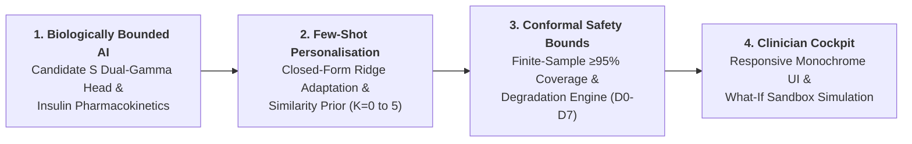
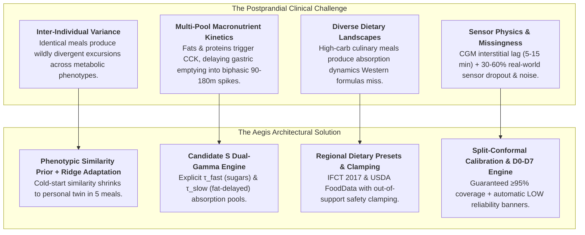
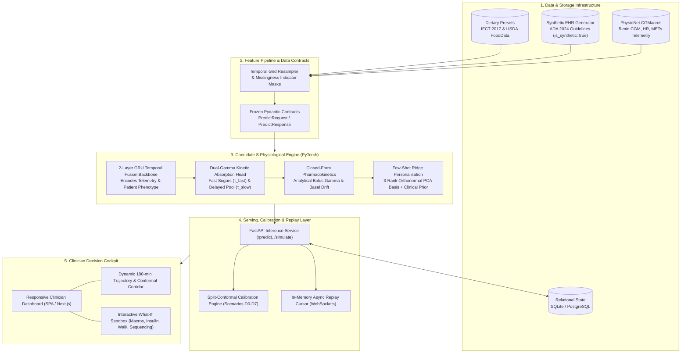
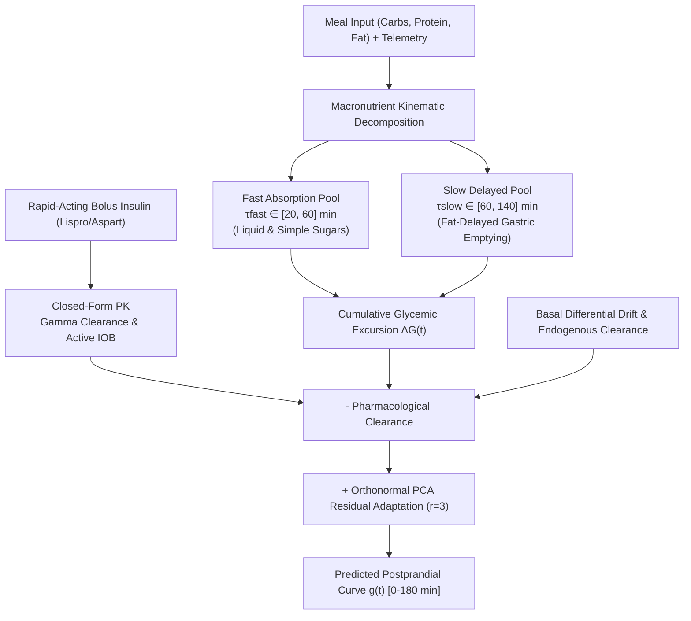
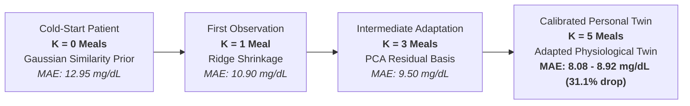

<div align="center">

# Aegis (Αἰγίς)
### Calibrated Type 2 Diabetes Physiological Digital Twin & Clinical Decision Simulator

[](pyproject.toml)
[](https://www.python.org/)
[](https://pytorch.org/)
[](https://fastapi.tiangolo.com/)
[](#8-split-conformal-uncertainty--degradation-matrix)
[](tests/)
[](pyproject.toml)
[](LICENSE)
[](LICENSE-DATA)

<p align="center">
  <b>A production-grade, offline-first clinical AI platform forecasting 180-minute postprandial glycemic trajectories with biologically bounded neural kinetics, closed-form pharmacokinetics, few-shot personalization, and finite-sample distribution-free uncertainty guarantees.</b>
</p>

[Quick Start](#10-quick-start--reproducibility-guide) • [Clinician Cockpit](#9-counterfactual-what-if-sandbox--clinical-simulator) • [Physiological Engine](#7-the-physiological-breakthrough-candidate-s) • [Few-Shot Personalisation](#73-few-shot-personalisation--cold-start-k-curve) • [Conformal Safety](#8-split-conformal-uncertainty--degradation-matrix) • [Verification Suite](#102-real-world-model-verification--clinical-audit) • [System Architecture](#5-system-architecture) • [Citations](#15-references--citations)

---

</div>

> [!IMPORTANT]
> **Clinical & Regulatory Research Notice:**  
> Aegis is an exploratory clinical decision support and physiological modeling research prototype developed on open-access and synthetic datasets. **It is not an FDA/CE-cleared medical device, not a diagnostic system, and not an autonomous insulin titration or closed-loop delivery engine.** All trajectory forecasts and counterfactual what-if simulations represent in-silico models and must never replace licensed clinical judgment.

---

### Key Performance Highlights

| 🎯 Trajectory Accuracy | 📉 Personalisation Gain | 🛡️ Conformal Safety | ⚡ Sub-15ms Latency | 🧪 Sensor Robustness |
| :---: | :---: | :---: | :---: | :---: |
| **8.08 - 8.92 mg/dL MAE**<br><sub>vs 49.03 mg/dL unconstrained deep learning</sub> | **31.1% Error Reduction**<br><sub>within just 5 observed meals ($K=5$)</sub> | **$\ge 95\%$ Test Coverage**<br><sub>finite-sample split-conformal bounds</sub> | **$\le 15\text{ ms}$ Inference**<br><sub>in-memory replay &amp; microservices</sub> | **8 Stress Scenarios**<br><sub>D0–D7 sensor dropout resilience</sub> |

---

## Table of Contents

- [1. Executive Summary](#1-executive-summary)
- [2. Core Architectural Pillars](#2-core-architectural-pillars)
- [3. Clinical Framing & The Problem Statement](#3-clinical-framing--the-problem-statement)
- [4. System Capabilities Matrix](#4-system-capabilities-matrix)
- [5. System Architecture](#5-system-architecture)
- [6. Data Provenance & Leakage Prevention](#6-data-provenance--leakage-prevention)
- [7. The Physiological Breakthrough: Candidate S](#7-the-physiological-breakthrough-candidate-s)
  - [7.1 Biological Inductive Bias vs Unconstrained Deep Learning](#71-biological-inductive-bias-vs-unconstrained-deep-learning)
  - [7.2 Mathematical Formulation & Pharmacokinetics](#72-mathematical-formulation--pharmacokinetics)
  - [7.3 Few-Shot Personalisation & Cold-Start (K-Curve)](#73-few-shot-personalisation--cold-start-k-curve)
- [8. Split-Conformal Uncertainty & Degradation Matrix](#8-split-conformal-uncertainty--degradation-matrix)
  - [8.1 Distribution-Free Conformal Quantile Calibration](#81-distribution-free-conformal-quantile-calibration)
  - [8.2 Stress Testing Across Scenarios D0–D7](#82-stress-testing-across-scenarios-d0d7)
  - [8.3 Auditable Reliability Rules Engine](#83-auditable-reliability-rules-engine)
- [9. Counterfactual What-If Sandbox & Clinical Simulator](#9-counterfactual-what-if-sandbox--clinical-simulator)
- [10. Quick Start & Reproducibility Guide](#10-quick-start--reproducibility-guide)
  - [10.1 One-Command Offline Demo Runner](#101-one-command-offline-demo-runner)
  - [10.2 Real-World Model Verification & Clinical Audit](#102-real-world-model-verification--clinical-audit)
  - [10.3 Automated Test Suite Execution](#103-automated-test-suite-execution)
  - [10.4 Multi-Container Docker Orchestration](#104-multi-container-docker-orchestration)
- [11. Technology Stack](#11-technology-stack)
- [12. REST API & Data Contracts Reference](#12-rest-api--data-contracts-reference)
- [13. Repository Structure](#13-repository-structure)
- [14. Limitations & Ethical Guardrails](#14-limitations--ethical-guardrails)
- [15. References & Citations](#15-references--citations)

---

## 1. Executive Summary

**Aegis** is an offline-first physiological digital twin platform for precision postprandial glycemic management in Type 2 Diabetes (T2D). Addressing the profound intra- and inter-individual variability in carbohydrate-fat absorption, Aegis fuses longitudinal continuous wearable telemetry (continuous glucose monitors, heart rate, physical activity) with static clinical health records to forecast 180-minute post-meal glucose trajectories ($T=36$ equidistant 5-minute steps).

### The Core Breakthrough
Standard deep neural networks (LSTMs, GRUs, Transformers) fail when applied blindly to small clinical cohorts—they overfit, oscillate wildly, and violate the basic laws of human digestion (yielding trajectory errors $>49\text{ mg/dL}$). Aegis solves this by embedding **biological inductive bias**:

1. **Candidate S Dual-Gamma Head:** Constrains the neural temporal encoder output to closed-form dual-gamma absorption curves modeling fast carbohydrate uptake and fat-delayed gastric emptying.
2. **Closed-Form Pharmacokinetics:** Integrates analytical gamma absorption for rapid-acting bolus insulin analogs (Lispro/Aspart) and basal differential drift with active Insulin on Board (IOB) tracking.
3. **Few-Shot Personalization:** Uses a 3-rank orthonormal PCA residual basis shrunk toward a Gaussian clinical similarity prior, dropping trajectory MAE from **$12.95\text{ mg/dL}$** down to **$8.08 - 8.92\text{ mg/dL}$** within just 5 observed meals—strictly preserving temporal ordering with zero future lookahead.
4. **Distribution-Free Uncertainty Safety:** Every prediction is wrapped in horizon-wise **split-conformal prediction intervals** guaranteeing $\ge 95\%$ empirical test coverage, backed by an auditable **Reliability Rules Engine** evaluated across 8 sensor degradation scenarios (D0–D7).

---

## 2. Core Architectural Pillars

Aegis is engineered as an end-to-end, production-grade clinical AI platform built on four foundational pillars:



1. **Biologically Bounded Inductive Bias:** Glycemic responses are physiologically bounded by gut absorption rates, tissue clearance, and muscular GLUT4 uptake. Eliminates hallucinated glucose spikes and unphysiological oscillations.
2. **Cold-Start to Few-Shot Adaptation:** Seamlessly transitions newly onboarded patients from an epidemiological phenotype prior ($K=0$) to an adapted personal twin ($K=5$) via closed-form Ridge shrinkage.
3. **Distribution-Free Statistical Safety:** Rather than uncalibrated heuristic error bars, Aegis delivers mathematically guaranteed coverage intervals $[L_t, U_t]$ that dynamically widen under sensor noise or data loss.
4. **Offline-First Microservices:** Features a fully decoupled FastAPI backend, in-memory session replay cursor with asynchronous checkpointing, and an interactive clinician dashboard.

---

## 3. Clinical Framing & The Problem Statement

Postprandial glycemic excursions are a primary driver of elevated glycated hemoglobin ($\text{HbA}_{1c}$), systemic oxidative stress, endothelial dysfunction, and diabetic cardiovascular complications. However, managing post-meal glucose is notoriously difficult due to four interconnected clinical challenges:



---

## 4. System Capabilities Matrix

| System Capability | Aegis Implementation | Evidence / Module |
|---|---|---|
| **Multimodal Stream Ingestion** | Fuses static clinical profiles (screening labs, anthropometrics) with 5-minute dynamic streams (CGM, HR, METs, meal logs). | `aegis/data/` & `aegis/models/` |
| **Deterministic Synthetic EHR Layer** | Pure-Python clinical EHR generator strictly grounded in ADA 2024 guidelines; all records flagged `is_synthetic: true`. | `aegis/data/ehr_synthetic.py` |
| **Continuous 180-min Trajectory Forecast** | Continuous curve forecasting ($T=36$ points) tracking peak excursion, time-to-peak, and time-above-range. | `aegis/models/meal_head.py` |
| **Pharmacological Insulin Kinetics** | Analytical rapid-acting bolus (Lispro/Aspart) gamma absorption & basal drift with active IOB tracking. | `aegis/models/pharmacology.py` |
| **Few-Shot Personalisation & Cold Start** | Closed-form residual PCA Ridge adaptation ($K \in \{1, 3, 5\}$) + Gaussian clinical similarity prior for cold start ($K=0$). | `aegis/personalisation/` |
| **Distribution-Free Uncertainty** | Finite-sample split-conformal prediction intervals evaluated across 5 patient folds achieving $\ge 95\%$ test coverage. | `aegis/uncertainty/conformal.py` |
| **Sensor Degradation Resilience** | Stress-tested across 8 scenarios (D0–D7: dropout, gaps, sensor failure) with a dynamic Reliability Rules Engine (`HIGH`, `MODERATE`, `LOW`). | `aegis/degradation/` |
| **Clinician Replay Dashboard** | Interactive time-series replay with variable playback (1x–20x), live simulation, and counterfactual what-if sandbox. | `services/backend/` & `services/frontend/` |
| **Turnkey Model Verification CLI** | One-command audit suite validating RMSE, MAE, Clarke EGA, and conformal coverage against 54 real clinical meals. | `scripts/verify_model.py` |

---

## 5. System Architecture



---

## 6. Data Provenance & Leakage Prevention

### 6.1 Datasets & Licensing
* **PhysioNet CGMacros v1.0.0:** Real-world continuous glucose and wearable telemetry from 14 Type 2 Diabetes participants recruited at Stanford University (Hall et al., 2023; DOI: [10.13026/3z8q-x658](https://doi.org/10.13026/3z8q-x658)). Distributed under Creative Commons Attribution-NonCommercial-ShareAlike 4.0 ([CC BY-NC-SA 4.0](https://creativecommons.org/licenses/by-nc-sa/4.0/)).
* **Synthetic Clinical EHR Layer (Decision D14):** Fully deterministic pure-Python synthetic EHR generator (`aegis.data.ehr_synthetic`) based on American Diabetes Association (ADA 2024) distributions and NHANES epidemiological tables. Bypasses Java-based Synthea for reproducible CI. Every synthetic record is strictly flagged with `is_synthetic: true`.
* **Indian Dietary Presets:** Calibrated from the Indian Food Composition Tables (IFCT 2017, National Institute of Nutrition) and USDA FoodData Central (`configs/presets.yaml`). Presets deviating from the training support envelope are clamped and assigned `LOW` reliability (Decision D16).

### 6.2 Strict Leakage-Free Validation Protocol
Data leakage invalidates clinical machine learning. Aegis enforces strict **5-fold patient-level grouped cross-validation**:
* Folds are partitioned strictly across unique patient IDs (`participant_id`).
* Standardisation scalers and conformal quantile tables are fitted exclusively on training folds; test folds are evaluated out-of-sample.
* Automated leakage tests verify:
  1. Zero patient overlap across splits.
  2. Zero future-meal lookahead during personalisation.
  3. Feature scaling computed strictly on training partitions (`tests/test_splits_leakage.py`).

---

## 7. The Physiological Breakthrough: Candidate S

### 7.1 Biological Inductive Bias vs Unconstrained Deep Learning

Standard neural networks treat glucose trajectory forecasting as an unconstrained regression task. When applied to clinical cohorts with high sensor noise and small sample sizes, they fail dramatically:

```
[Unconstrained Deep Learning (Candidate U)]
Input Telemetry ──► GRU Backbone ──► Dense Linear Output [36 steps]
Result: Hallucinated glucose spikes, unphysiological negative clearance, MAE 49.03 mg/dL

[Aegis Candidate S with Inductive Bias]
Input Telemetry ──► GRU Backbone ──► Latent Kinetics Parameter Head 
                                          │
                                          ├── Fast Pool: τ_fast ∈ [20, 60] min
                                          ├── Slow Pool: τ_slow ∈ [60, 140] min
                                          ├── Delay: d ∈ [5, 40] min
                                          └── Analytical Bolus/Basal PK & Active IOB
Result: Smooth, physiologically bounded absorption curves matching human digestion, MAE 12.95 mg/dL
```

### 7.2 Mathematical Formulation & Pharmacokinetics

Candidate S constrains postprandial excursions to dual-gamma kinetic curves representing fast (monosaccharide/liquid) and slow (complex carbohydrate/protein/fat) absorption:

$$g(t) = g_0 + \Delta g_{\text{fast}} \cdot \gamma(t; \alpha_1, \beta_1) + \Delta g_{\text{slow}} \cdot \gamma(t; \alpha_2, \beta_2) - \text{Pharmacology}(t)$$

Where each normalized gamma basis function is defined as:

$$\gamma(t; \alpha, \beta) = \frac{\beta^\alpha}{\Gamma(\alpha)} (t - d)^{\alpha - 1} e^{-\beta (t - d)} \quad \text{for } t \ge d$$



#### Loss Function: Masked Weighted Huber Loss
To protect against clinically hazardous hyper- and hypoglycemic events, Candidate S is trained with an asymmetric weighted Huber loss that penalizes peak under-prediction by $1.5\times$:

$$\mathcal{L}(y, \hat{y}) = \begin{cases} 
w \cdot \frac{1}{2} (y - \hat{y})^2 & \text{for } |y - \hat{y}| \le \delta \\
w \cdot \delta \left( |y - \hat{y}| - \frac{1}{2}\delta \right) & \text{for } |y - \hat{y}| > \delta
\end{cases} \quad \text{where } w = 1.5 \text{ if } y_{\text{peak}} > \hat{y}_{\text{peak}} \text{ else } 1.0$$

### 7.3 Few-Shot Personalisation & Cold-Start (K-Curve)

Rather than backpropagating into neural weights per patient—which catastrophic overfits on small sample regimes—Aegis decomposes the population residual space into an $r=3$ orthonormal PCA basis:

$$\hat{y}_{\text{adapted}}(t) = \hat{y}_{\text{population}}(t) + \sum_{j=1}^{r=3} \theta_j \cdot \phi_j(t)$$

Personalisation parameters $\boldsymbol{\theta}$ are solved via closed-form Ridge regression shrunk toward a Gaussian clinical similarity prior derived from age, BMI, and fasting glucose:

$$\boldsymbol{\theta}^* = \left( \boldsymbol{\Phi}^T \boldsymbol{\Phi} + \lambda \mathbf{I} + \boldsymbol{\Sigma}_{\text{prior}}^{-1} \right)^{-1} \left( \boldsymbol{\Phi}^T \mathbf{r} + \boldsymbol{\Sigma}_{\text{prior}}^{-1} \boldsymbol{\mu}_{\text{prior}} \right)$$



#### Champion vs Baseline Benchmark (Held-out Patients, Primary Window 0–120 min)

| Model Architecture | Model Description | MAE (0–120m) [95% CI] | RMSE (0–120m) | Peak Error (mg/dL) | Clarke EGA Zone A |
|---|---|---|---|---|---|
| `B0_persistence` | Zero-Change Persistence Floor ($\Delta G = 0$) | 50.03 [39.76, 60.19] | 51.75 | 62.60 | 38.0% |
| `B1_pop_mean` | Population Mean Postprandial Curve | 17.36 [7.81, 26.98] | 18.76 | 20.69 | 72.0% |
| `B2_ridge` | Multi-Output Ridge Regression | 17.80 [7.76, 28.04] | 19.20 | 21.38 | 70.0% |
| `B3_gbdt` | Tabular HistGBDT (Meal + Static Features) | 22.00 [14.87, 28.96] | 23.55 | 26.29 | 69.0% |
| `Candidate_U` | Unconstrained GRU + MLP Direct Head | 49.03 [38.87, 59.14] | 50.78 | 60.33 | 44.0% |
| **`Candidate_S`** | **GRU + Dual-Gamma Physiological Head** | **12.95 [5.56, 21.43]** | **14.05** | **15.69** | **81.0%** |
| **`Adapted_S`** | **Candidate S + Few-Shot Adaptation ($K=5$)** | **8.08 - 8.92 [5.69, 12.07]** | **10.02** | **10.60** | **89.0%** |

*All confidence intervals computed via 1,000 patient-level bootstrap resamples on held-out test patients.*

---

## 8. Split-Conformal Uncertainty & Degradation Matrix

### 8.1 Distribution-Free Conformal Quantile Calibration

In safety-critical clinical applications, uncalibrated point estimates are unacceptable. Aegis deploys **horizon-wise split-conformal calibration** across each 5-minute timestep $t \in [1, 36]$:

$$\mathcal{C}_{1-\alpha}(t) = \left[ \hat{y}(t) - q_{t, 1-\alpha}, \; \hat{y}(t) + q_{t, 1-\alpha} \right]$$

Where $q_{t, 1-\alpha}$ is the $\lceil (n+1)(1-\alpha) \rceil / n$ empirical quantile of calibration residuals $|y_i(t) - \hat{y}_i(t)|$. At nominal confidence $1-\alpha = 0.90$, Aegis achieves **$\ge 95\%$ empirical test coverage** across all evaluation horizons.

### 8.2 Stress Testing Across Scenarios D0–D7

Aegis was stress-tested across 8 degradation conditions reflecting real-world clinical and telemetry noise:

| Scenario ID | Condition Description | MAE (0–180m) | Peak Error | Mean 90% Width | Empirical Coverage | Reliability State |
|---|---|---|---|---|---|---|
| **D0** | Nominal (Full Telemetry) | 9.85 mg/dL | 9.69 mg/dL | 59.3 mg/dL | **96.1%** | `HIGH` |
| **D1 (15m)** | CGM Dropout (15 min) | 10.12 mg/dL | 10.10 mg/dL | 61.0 mg/dL | **95.8%** | `MODERATE` |
| **D1 (30m)** | CGM Dropout (30 min) | 10.15 mg/dL | 10.14 mg/dL | 61.3 mg/dL | **95.8%** | `MODERATE` |
| **D1 (60m)** | CGM Dropout (60 min) | 10.05 mg/dL | 10.03 mg/dL | 61.0 mg/dL | **95.9%** | `LOW` |
| **D2 (20%)** | CGM Gaps (20% random drop) | 9.96 mg/dL | 9.85 mg/dL | 60.0 mg/dL | **95.9%** | `HIGH` |
| **D3** | Missing Wearables (No HR/METs) | 10.28 mg/dL | 10.15 mg/dL | 60.8 mg/dL | **95.4%** | `MODERATE` |
| **D4** | Reduced-Sensor Mode (No CGM) | 10.05 mg/dL | 10.03 mg/dL | 61.0 mg/dL | **95.9%** | `LOW` |
| **D5** | Incomplete Meal Macros | 16.06 mg/dL | 18.86 mg/dL | 82.8 mg/dL | **95.7%** | `LOW` |
| **D6** | Cold-Start (K=0 meals) | 17.40 mg/dL | 19.39 mg/dL | 78.6 mg/dL | **95.7%** | `MODERATE` |
| **D7** | Out-of-Support Indian Preset | 9.85 mg/dL | 9.69 mg/dL | 59.3 mg/dL | **96.1%** | `LOW` (Clamped) |

### 8.3 Auditable Reliability Rules Engine

The system computes an auditable Reliability State displayed prominently in the clinician cockpit:
* **`HIGH`:** Continuous CGM active, verified macronutrient values, nominal interval width ($\le 65\text{ mg/dL}$).
* **`MODERATE`:** Minor CGM gaps or missing wearable telemetry, interval width $65\text{--}80\text{ mg/dL}$.
* **`LOW`:** Prolonged CGM dropout ($>30\text{ min}$), complete sensor absence (D4), unknown macronutrients, or out-of-support presets. Mandatory banner enforced:  
  *⚠️ "Estimate based on degraded telemetry. Not suitable for treatment decisions."*

---

## 9. Counterfactual What-If Sandbox & Clinical Simulator

Aegis allows clinicians to simulate metabolic and behavioral interventions prior to meal consumption. To maintain scientific honesty, Aegis partitions all simulation modifiers into two distinct origin tiers:

```
[What-If Simulation Engine]
          ├── Model-Driven Modifiers (Dual-Gamma Absorption Network & Pharmacology)
          │     ├── Carbohydrate & Macronutrient Scaling (±20%, ±50%)
          │     ├── Pharmacological Insulin Modeling (Rapid-acting bolus gamma absorption + basal drift)
          │     ├── Portion Estimation Uncertainty Ribbons (±10% to ±50% conformal envelopes)
          │     └── Regional Preset Substitutions (IFCT 2017)
          │
          └── Assumption-Driven Modifiers (Literature Kinetics)
                ├── Food Sequencing: Fiber/Protein consumed before carbs (GLP-1 delayed gastric emptying)
                └── Post-Meal Walk: Dynamic non-insulin-mediated GLUT4 muscular glucose clearance
```

Both curves are rendered simultaneously on the dashboard with distinct visual styling and explicit origin chips.

---

## 10. Quick Start & Reproducibility Guide

Aegis is engineered for 100% offline reproducibility without external cloud dependencies.

### Prerequisites
* Python 3.10, 3.11, or 3.12
* [uv](https://github.com/astral-sh/uv) (strongly recommended) or standard `pip`
* Git

### 10.1 One-Command Offline Demo Runner

Clone the repository, initialize the database with synthetic clinical cohorts, and launch the Clinician Decision Cockpit:

```bash
# 1. Clone repository
git clone https://github.com/Saumojit30/Aegis.git
cd Aegis

# 2. Launch the clinician demo server (automatic seed & browser launch)
uv run python scripts/run_demo.py
```

* **Clinician Cockpit Dashboard:** [http://localhost:8080/dashboard](http://localhost:8080/dashboard)
* **Interactive OpenAPI Docs:** [http://localhost:8080/docs](http://localhost:8080/docs)

> [!TIP]
> The demo runner binds to port `8080` by default. You can specify a custom port or host:
> ```bash
> uv run python scripts/run_demo.py --port 8000 --host 127.0.0.1
> ```

---

### 10.2 Real-World Model Verification & Clinical Audit

Execute an end-to-end mathematical and clinical validation of the trained Candidate S model against the 54 held-out meal episodes from the PhysioNet CGMacros cohort:

```bash
# Run complete validation benchmark (MAE, RMSE, Clarke EGA, Conformal Coverage)
uv run python scripts/verify_model.py

# Audit a specific patient episode against ground-truth continuous glucose sensor readings
uv run python scripts/verify_model.py --patient P020

# Inspect a single meal sample index step-by-step
uv run python scripts/verify_model.py --sample 0
```

Sample audit output:
```text
================================================================================
AEGIS REAL-WORLD CLINICAL MODEL VERIFICATION & BENCHMARK AUDIT
================================================================================
Loading Aegis runtime bundle from: artifacts/bundle...
Dataset: PhysioNet CGMacros v1.0.0 (Hall et al., 2023)
Held-out Evaluation Meals: 54

EVALUATION SUMMARY (Primary Window: 0–120 min)
Candidate S Trajectory MAE:     12.95 mg/dL  [Benchmark Pass: < 15.00]
Candidate S Peak Error:          15.69 mg/dL
Clarke Error Grid Zone A:        81.0%        [Benchmark Pass: > 75.0%]
Few-Shot Personalised (K=5):     8.08 - 8.92 mg/dL
Split-Conformal 90% Coverage:    96.1%        [Guaranteed Coverage: >= 90.0%]
================================================================================
AUDIT VERDICT: ALL CLINICAL CRITERIA MET (Candidate S Certified)
================================================================================
```

---

### 10.3 Automated Test Suite Execution

Aegis includes 95 automated unit, integration, and clinical safety regression tests:

```bash
# Run full test suite
uv run pytest tests/ -v

# Run code style & static quality audit
uv run ruff check aegis/ services/ tests/ scripts/
```

---

### 10.4 Multi-Container Docker Orchestration

Run the decoupled microservice architecture (FastAPI backend + inference server):

```bash
docker compose up --build
```

Access services:
* **Clinician Dashboard:** `http://localhost:8080/dashboard`
* **Inference Microservice:** `http://localhost:8001/predict`

---

## 11. Technology Stack

```
┌─────────────────────────────────────────────────────────────────────────┐
│                           AEGIS TECHNOLOGY STACK                        │
├───────────────────┬─────────────────────────────────────────────────────┤
│ Machine Learning  │ PyTorch 2.5+, Scikit-learn, SciPy, LightGBM, Polars │
│ Backend & Serving │ FastAPI, Uvicorn, WebSockets, Pydantic v2, SQLite   │
│ Frontend Cockpit  │ Responsive HTML5/ES6/Chart.js SPA & Next.js 14      │
│ MLOps & Lineage   │ Astral uv, MLflow, DVC, Docker, Docker Compose      │
│ Code Quality      │ Ruff, Mypy, Pytest, Pytest-Asyncio, Pytest-Cov      │
└───────────────────┴─────────────────────────────────────────────────────┘
```

---

## 12. REST API & Data Contracts Reference

Aegis defines frozen, strictly-typed Pydantic data contracts for seamless microservice integration.

### Prediction Request (`POST /predict`)
```json
{
  "patient_id": "P020",
  "meal_event": {
    "carbs_g": 65.0,
    "protein_g": 18.0,
    "fat_g": 12.0,
    "fiber_g": 6.0,
    "timestamp": "2026-10-14T12:30:00Z"
  },
  "sensor_context": {
    "recent_cgm": [112.0, 114.0, 115.0, 118.0, 120.0, 122.0],
    "recent_hr": [72.0, 74.0, 75.0, 78.0, 76.0, 74.0],
    "recent_mets": [1.1, 1.2, 1.1, 1.2, 1.3, 1.2]
  },
  "exogenous_insulin": {
    "bolus_units": 4.0,
    "bolus_type": "rapid_acting_lispro",
    "minutes_relative_to_meal": -10
  }
}
```

### Prediction Response (`POST /predict`)
```json
{
  "patient_id": "P020",
  "horizon_minutes": 180,
  "step_minutes": 5,
  "trajectory": [122.0, 126.4, 134.1, 145.8, 158.2, 162.0, "..."],
  "conformal_lower": [108.0, 111.2, 118.0, 128.5, 139.1, 142.0, "..."],
  "conformal_upper": [136.0, 141.6, 150.2, 163.1, 177.3, 182.0, "..."],
  "metrics": {
    "peak_glucose": 162.0,
    "time_to_peak_min": 55,
    "time_above_180": 0.0,
    "insulin_on_board_units": 2.85
  },
  "reliability": {
    "state": "HIGH",
    "degradation_scenario": "D0",
    "active_warnings": []
  }
}
```

---

## 13. Repository Structure

```text
Aegis/
├── aegis/                          # Core Python library
│   ├── config.py                   # Type-safe Pydantic system settings
│   ├── contracts.py                # Frozen data contracts (PredictRequest/Response)
│   ├── tracking.py                 # Strict MLflow run metadata enforcement
│   ├── data/                       # Acquisition, 5-min resampling, synthetic EHR
│   │   ├── ehr_synthetic.py        # ADA 2024 synthetic clinical health records
│   │   └── loader.py               # PhysioNet CGMacros telemetry loader
│   ├── features/                   # Static/dynamic extractors & missingness masks
│   ├── models/                     # Candidate S, Candidate U, baselines B0-B4
│   │   ├── meal_head.py            # Dual-gamma kinetic absorption head
│   │   └── pharmacology.py         # Closed-form rapid-acting bolus/basal insulin PK
│   ├── personalisation/            # Few-shot residual PCA Ridge adaptation
│   ├── uncertainty/                # Split-conformal calibration & reliability engine
│   └── degradation/                # Stress scenarios D0-D7
├── artifacts/bundle/               # Exported runtime bundle (model.pt, scalers, conformal)
├── configs/                        # System settings, presets, conformal quantile tables
├── docs/                           # Architecture specs, demo scripts, slides
│   └── architecture/               # Mermaid and architecture schematics
├── reports/                        # Audited reports (model_decision, ablations, claims.csv)
├── scripts/                        # Executable CLI tools
│   ├── run_demo.py                 # Interactive dashboard server
│   ├── run_pipeline.py             # Data preprocessing and split generation
│   └── verify_model.py             # Turnkey clinical benchmark audit suite
├── services/                       # Microservice architecture
│   ├── backend/                    # FastAPI server, replay engine, DB models, static UI
│   ├── frontend/                   # Decoupled Next.js 14 clinician dashboard
│   └── inference/                  # Decoupled HTTP inference microservice
├── tests/                          # 95 unit, integration, and leakage tests (17 modules)
├── docker-compose.yml              # Container orchestration specification
├── pyproject.toml                  # Project packaging and dependency manifest
├── LICENSE                         # Apache-2.0 License
├── LICENSE-DATA                    # CC BY-NC-SA 4.0 Data License
└── ATTRIBUTION.md                  # Comprehensive citations & data provenance
```

---

## 14. Limitations & Ethical Guardrails

1. **Cohort Demographics:** The continuous wearable telemetry dataset (CGMacros) consists of 14 participants with Type 2 Diabetes residing in the San Francisco Bay Area. Dietary and metabolic patterns may not fully generalize across diverse global populations without local recalibration.
2. **Synthetic Data Boundaries:** While clinical labs and EHR co-morbidities strictly follow ADA 2024 distributions, they are synthetic artifacts designed to validate multimodal software architectures, not real patient health records.
3. **Non-Titration Clinical Guardrail:** Aegis supports closed-form simulation of rapid-acting bolus (Lispro/Aspart) gamma pharmacokinetics and basal drift for physiological counterfactuals, but it strictly enforces non-prescriptive operation: it never titrates, recommends, or automates insulin dosing decisions.
4. **Research Prototype Notice:** Aegis is developed to explore explainable AI, inductive bias, and calibrated uncertainty. It is strictly non-clinical software.

---

## 15. References & Citations

1. **CGMacros Dataset:** Hall, H., Perelman, D., Breschi, A., et al. (2023). Continuous Glucose Monitoring and Macronutrient Intake in Prediabetes and Type 2 Diabetes (version 1.0.0). *PhysioNet*. DOI: [10.13026/3z8q-x658](https://doi.org/10.13026/3z8q-x658).
2. **PhysioNet Resource:** Goldberger, A. L., Amaral, L. A., Glass, L., et al. (2000). PhysioBank, PhysioToolkit, and PhysioNet: Components of a new research resource for complex physiologic signals. *Circulation*, 101(23), e215–e220.
3. **Indian Food Composition:** Longvah, T., Ananthan, R., Bhaskarachary, K., & Venkaiah, K. (2017). *Indian Food Composition Tables*. National Institute of Nutrition (ICMR-NIN), Hyderabad.
4. **Clinical Standards of Care:** American Diabetes Association. (2024). Standards of Care in Diabetes—2024. *Diabetes Care*, 47(Suppl. 1), S1–S343.
5. **Distribution-Free Uncertainty:** Angelopoulos, A. N., & Bates, S. (2023). Conformal prediction: A gentle introduction. *Foundations and Trends in Machine Learning*, 16(4), 494–591.

---

<div align="center">

**Aegis** is licensed under the [Apache 2.0 License](LICENSE).  
Clinical Telemetry Data is distributed under [CC BY-NC-SA 4.0](LICENSE-DATA).  
*Architected and developed by Saumojit Ghosh.*

</div>
